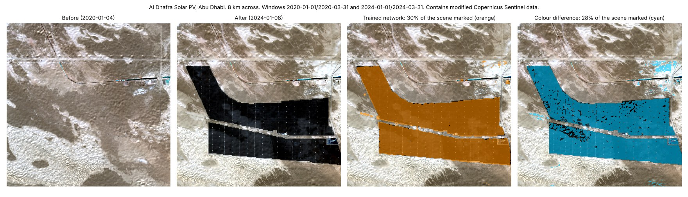
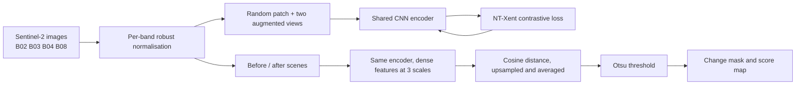

# Self-Supervised Satellite Change Detection

[](https://github.com/inshal8717/self-supervised-satellite-change-detection-train/actions/workflows/ci.yml)

**In plain words:** give it two satellite photos of the same place, taken months apart, and it marks the pixels that
changed, such as cleared forest, new buildings or flooding. Most systems like this need people to hand-label
thousands of "this changed" examples. This one first learns what satellite images look like from **unlabelled**
photos, then compares what its neural network "sees" in the two photos.

**Project page (pictures, results, glossary):** https://inshal8717.github.io/self-supervised-satellite-change-detection-train/

> **Status: a research project.** Tested on real data in v2 (OSCD, 24 Sentinel-2 scene pairs with change masks).
> The original network loses clearly to a plain colour difference there. An improved version, trained on
> before/after pairs without labels, is better than the colour difference on most city scenes but fails on
> farmland, and **does not beat it overall** on the measure fixed in advance (test F1 0.185 against 0.270). On
> synthetic scenes every method is near perfect, so those numbers only check that the pipeline runs. Earlier figures
> in this repository (AUROC 0.98) were measured on the training scenes and are withdrawn.

## What it looks like

One held-out synthetic scene. Orange means "changed". The first two are the question, the third is the answer key,
and the rest are attempts at the answer.

| Before | After | What really changed | Trained network | Same network, old scaling | Colour difference, raw |
| :---: | :---: | :---: | :---: | :---: | :---: |
|  |  |  |  |  |  |

With the old scaling, the network marks most of the scene as changed. With the fix it finds the patch, though it still
marks some extra pixels.

## Results on held-out synthetic scenes

The network was pretrained on scenes 0–7 and scored on scenes 8–11, which it never saw. Every method uses the same
scenes and the same per-scene Otsu cut-off. Reproduce with `python scripts/reproduce_results.py`.

| Method | AUROC | F1 | IoU | Precision | Recall |
| --- | ---: | ---: | ---: | ---: | ---: |
| Trained network (shared stretch, current) | 0.999 | 0.739 | 0.588 | 0.588 | 1.000 |
| Same trained network, old per-photo stretch | 0.491 | 0.181 | 0.101 | 0.103 | 0.798 |
| Same network, untrained (random weights) | 0.998 | 0.875 | 0.780 | 0.825 | 0.944 |
| Colour difference, shared stretch | 1.000 | 0.999 | 0.999 | 0.999 | 1.000 |
| Colour difference, per-photo stretch | 0.740 | 0.240 | 0.138 | 0.144 | 0.757 |
| Colour difference, raw values | 1.000 | 1.000 | 1.000 | 1.000 | 1.000 |

How to read it: AUROC is a score from 0 to 1 for how well a method ranks truly changed pixels above unchanged ones.
0.5 is the same as guessing and 1.0 is perfect. F1 and IoU score the final changed/unchanged map the same way. The
project page has a glossary.

**What was wrong, and the fix.** The code used to stretch each photo's brightness using that photo's own percentiles
(`normalize_reflectance`). A large change in one photo shifts its stretch, so the whole scene looked different from the
other photo. Both dates now share one stretch (`normalize_pair`, used by `score_pair`). The same trained weights went
from AUROC 0.491 to 0.999 with no retraining, which is the first two rows. `stretch="per_photo"` keeps the old
behaviour so that comparison stays reproducible.

**What the table does not show.** Three things limit the conclusions:

1. **Pretraining is not shown to help.** The same network with random, untrained weights scores AUROC 0.998, and a
   better F1 (0.875) than the trained one (0.739).
2. **The network does not beat a plain colour difference.** Subtracting the photos, with no network, scores 1.000 on
   AUROC and F1 0.999.
3. **The automatic cut-off over-marks changed pixels for the network.** It ranks pixels almost perfectly (AUROC 0.999)
   but Otsu thresholding picks a cut-off that gives precision 0.588, so the final map is worse than the ranking.

The scenes are synthetic, with flat, distinct changed patches and mild noise, so every method here finds them easily.
These numbers check that the pipeline runs and show how the methods compare. They do not predict real-world accuracy.

## Results on real data (v2)

The synthetic scenes above are too easy to separate the methods, so v2 tests on real imagery: the
[OSCD benchmark](docs/DATA_SOURCES.md), split by scene into 9 train, 5 validation and 10 test scenes. Thresholds are
fitted on the validation scenes and the test scenes are scored once per configuration. Three seeds per network.

F1 and the other map metrics below count all test pixels together. This was the measure fixed before testing.

<!-- v2:test_combined file=v2_results_final.json base=v2_results.json -->
| Method | AUROC | PR-AUC | F1 | IoU | Precision | Recall |
| --- | ---: | ---: | ---: | ---: | ---: | ---: |
| v1 network, as it was (Part A) | 0.628 ± 0.005 | 0.075 ± 0.002 | 0.127 ± 0.003 | 0.068 ± 0.002 | 0.079 ± 0.003 | 0.330 ± 0.062 |
| Improved network (after the loop) | 0.785 ± 0.007 | 0.111 ± 0.004 | 0.185 ± 0.004 | 0.102 ± 0.002 | 0.125 ± 0.004 | 0.355 ± 0.002 |
| Improved scoring, untrained network | 0.694 ± 0.003 | 0.085 ± 0.003 | 0.155 ± 0.004 | 0.084 ± 0.002 | 0.092 ± 0.003 | 0.503 ± 0.021 |
| Colour difference, shared stretch | 0.738 | 0.214 | 0.270 | 0.156 | 0.261 | 0.278 |
| Colour difference, raw values | 0.760 | 0.291 | 0.330 | 0.197 | 0.442 | 0.263 |
<!-- /v2 -->

What this shows:

1. **The v1 network does not work on real data.** It is far below a colour difference, and pretraining did not beat
   random weights.
2. **The improved network is a clear step up from v1,** from three changes found on validation scenes: drop the
   coarsest feature scale, add a loss that compares the same patch at two dates (no labels), and lower the contrastive
   temperature.
3. **It still does not beat the colour difference overall.** Averaged per scene it does (F1 0.273 against 0.241), and
   it wins on 5 or 6 of 10 scenes. But on three scenes with farmland it marks seasonal crop change as change, and those
   false marks decide the pooled score.
4. **Validation did not warn about this.** On the five validation scenes, all of them cities, the improved network
   was ahead (0.292 against 0.224).

Details, per-scene tables and failure examples: [`docs/V2_RESULTS.md`](docs/V2_RESULTS.md). Every experiment, kept
or discarded: [`docs/V2_EXPERIMENTS.md`](docs/V2_EXPERIMENTS.md). Summary of the improvement loop:
[`docs/V2_IMPROVEMENT_SUMMARY.md`](docs/V2_IMPROVEMENT_SUMMARY.md).

### Case studies in the UAE

Three places with a large, documented change, fetched as real Sentinel-2 pairs: the Expo 2020 site, the Al Dhafra
solar plant and the Mohammed bin Rashid Al Maktoum Solar Park. There is no answer key for these, so they are shown
and discussed, not scored.



*Al Dhafra Solar PV, Abu Dhabi, January 2020 and January 2024. Orange: marked by the improved network. Cyan: marked
by the colour difference. Contains modified Copernicus Sentinel data.*

Both methods find the solar plant and the Expo site. Both miss most of the new mirror field at the solar park, where
the change is low in contrast. Write-up with sources: [`docs/CASE_STUDIES.md`](docs/CASE_STUDIES.md). A before/after
slider is on the project page (`docs/case-studies.html`).

### Reproduce the real-data results

```bash
pip install -e ".[geo,fetch,test,figures]"
python scripts/fetch_benchmark.py                                           # OSCD, about 513 MB
bash scripts/run_queue_v2.sh baseline:42 baseline:43 baseline:44 \
    pair_dense_t01:42 pair_dense_t01:43 pair_dense_t01:44                   # about 70 minutes on 2 CPU cores
python scripts/evaluate_v2.py --config configs/v2/pair_dense_t01.json --seeds 42 43 44        # validation scenes only
python scripts/run_case_studies.py --fetch                                  # UAE sites
python scripts/render_v2_tables.py --check                                  # tables match the result files
```

`evaluate_v2.py` never opens a test file unless `--split test` is given, and it records every test pass in
`docs/data/v2_test_ledger.json`.

## Architecture



The encoder is fully convolutional: a stem and three stride-2 stages with widths `32 → 64 → 128 → 256`. Feature
distances from all three stages are resized to the input size and averaged.

## Quick start

Requires Python 3.10 or newer. CPU is enough.

```bash
pip install -e ".[geo,test,lint,dashboard]"

# Smoke test: 2 epochs on 8 synthetic scenes, about a minute on CPU
python scripts/demo.py --synthetic

# Full held-out experiment and the project page data (a few minutes on CPU)
python scripts/reproduce_results.py
python scripts/build_site.py      # writes docs/index.html

# Interactive dashboard at http://localhost:8501
streamlit run app.py
```

Running `scripts/demo.py` on its own (without `--synthetic`) uses `data/real` when it holds image pairs and masks, and
generates synthetic data otherwise.

### Run change detection on your own pair

```bash
python -m sat_change.predict \
  --before before.tif --after after.tif \
  --checkpoint outputs/demo/best.pt \
  --output outputs/change.tif
```

This writes the score map, a binary mask (`change_mask.tif`), and a JSON summary. Use `--threshold` to set a fixed
threshold instead of Otsu.

## Data layout

Imagery is `C × H × W`, as `.npy` or `.tif`/`.tiff`. Images with the same scene key and different dates form a pair.
The scene key is the filename with its trailing date removed. Within a scene, the earliest and latest acquisitions form
the before/after pair. Anything inside a `masks/` folder is ground truth and is never used as imagery.

```text
data/real/
  vegas/
    images/vegas_2023-03-31.tif
    images/vegas_2023-09-07.tif
    masks/vegas.tif        # optional, for evaluation
```

Sentinel-2 L2A bands `B02, B03, B04, B08` at 10 m are the expected inputs. Reflectance can be `0..1` or Sentinel's
integer scale (`0..10000`).

## Real satellite data

`scripts/fetch_sentinel2.py` downloads Sentinel-2 L2A surface reflectance from Microsoft Planetary Computer. It needs
no account or API key, and it co-registers both dates onto one 10 m UTM grid. Install the extras first with
`pip install -e ".[fetch]"`.

```bash
python scripts/fetch_sentinel2.py \
  --center=-115.2,36.1 \
  --size 6 \
  --before 2023-01-01/2023-03-31 \
  --after 2023-08-01/2023-10-31 \
  --scene vegas \
  --output data/real \
  --cloud-max 25 \
  --limit 3 \
  --mask path/to/change_mask.tif
```

| Option | Meaning |
| --- | --- |
| `--center` | AOI centre as `lon,lat`. Use the `=` form for negative longitudes. |
| `--size` | AOI side length in km. |
| `--before`, `--after` | Acquisition windows as ISO date ranges. |
| `--scene` | Scene key used in all output filenames. |
| `--cloud-max` | Maximum scene-level cloud cover for candidate acquisitions. |
| `--limit` | Acquisitions to median-composite per window. Clouds, shadows and nodata are excluded (SCL mask). |
| `--mask` | Optional ground-truth change mask (GeoTIFF), written for evaluation. |

Without a mask you can still inspect the score maps, but IoU, F1 and AUROC are not computed.

Two things to know when fetching, both found on the UAE case studies:

- **Pairs that straddle January 2022.** Sentinel-2 images processed with baseline 04.00 or later store every value
  1000 higher. The script removes that offset, so both dates share one scale. Before this fix such a pair looked
  changed everywhere.
- **Bright ground and the cloud mask.** `--limit` composites exclude pixels that Sentinel-2's scene classification
  calls cloud or shadow. Over pale sand, bright roofs and mirror fields it is often wrong (31% of one Dubai image was
  discarded). Pass `--no-scl` for such scenes and rely on `--cloud-max` and the median instead.

To export the same inputs from Google Earth Engine instead, filter `COPERNICUS/S2_SR_HARMONIZED` by area, date and
cloud cover, mask clouds, make one composite per window, reproject both to the same grid, and name the files with the
scene key and window date.

## Methodology

Two augmented views of the same patch are positives. All other samples in the batch are negatives. Pretraining never
sees before/after pairs, so it learns from single images. Augmentations are flips, rotations, mild gain and bias
jitter, noise and blur, which keep spatial structure. At inference, the two dates are scaled with one shared stretch,
their features are compared with cosine distance at three scales. The scales are upsampled and averaged, and Otsu thresholding gives a
label-free mask.

**Evaluation caveats:** the held-out split is by scene, not by patch, which avoids spatial leakage. Each scene's
threshold is chosen by Otsu on that scene's own scores, so no label is used. Thresholds fitted on a separate validation
region would be more honest for deployment. Report precision-recall curves as well as F1, because changed pixels are
rare.

## Engineering trade-offs

- **Small CNN instead of a large pretrained backbone:** it trains on a CPU and keeps dense feature stages. A larger
  model might transfer better, at the cost of compute and pretrained-weight assumptions.
- **Self-supervised instead of supervised:** no annotation is needed. The price is a threshold-sensitive anomaly score,
  not a calibrated class probability.
- **Tiled inference with overlap:** the network runs tile by tile, which bounds memory per forward pass. Both input
  scenes are still loaded in full, and overlap adds runtime.
- **Shared stretch at inference, per-image stretch in training:** pretraining sees single photos, so each is
  stretched on its own. Scoring a pair uses one stretch for both dates, which is what fixed the original failure. The
  mismatch between the two did not hurt on the synthetic scenes, but training on shared-stretch pairs is untested.
- **AdamW with cosine decay:** a stable default for contrastive training. It is not tuned for any particular biome.

## v2: what was done, and what is next

The work order was [`docs/V2_PLAN.md`](docs/V2_PLAN.md), followed by the improvement loop in
[`docs/V2_MODEL_IMPROVEMENT.md`](docs/V2_MODEL_IMPROVEMENT.md).

Done:

- **Real-data test** on OSCD with a validation-fitted threshold and a ledger of test passes.
- **Local case studies** on three UAE sites, with sources for each change.
- **Better decision threshold.** A threshold fitted on validation scenes replaces per-scene Otsu for the benchmark.
- **Six improvement experiments,** each with its hypothesis written down before the run.
- **Two fixes to the Sentinel-2 fetch script** (see "Real satellite data").

Not done yet:

- **Fix the farmland failure.** Pretrain on more unlabelled pairs that include fields in different seasons, and
  add a farmland scene to validation. That needs a fresh test set, because the current one has now been looked at.
- **Harder synthetic test.** Add seasonal lighting shifts, clouds, small misregistration and sensor noise. On the
  current synthetic scenes a colour difference scores perfectly.
- **The untested experiments** listed at the end of [`docs/V2_EXPERIMENTS.md`](docs/V2_EXPERIMENTS.md).
- **Demo.** `app.py` exists. A before/after slider with the marks on top, as on the case-study page, would make it
  easier to show.

## Limitations

This is a research baseline, not an operational product.

- On real data (OSCD test scenes) the improved network does not beat a plain colour difference overall, and the
  original network is far below it. See "Results on real data (v2)".
- It marks seasonal change in farmland as change. On three of ten test scenes it ranks pixels worse than guessing.
- The real-data evaluation is small: ten test scenes and five validation scenes, all labelled for urban change only.
- On synthetic scenes every method is near perfect, so those results say nothing about real accuracy.
- The validation-fitted thresholds come from Level-1C imagery (OSCD). `fetch_sentinel2.py` downloads Level-2A. The
  UAE case studies apply the thresholds across that gap and are not scored.
- The model outputs a binary change mask. It does not identify the type of change.
- Inputs must already be co-registered at pixel level. Misalignment produces false positives.
- `sat_change.train` does not read manifests or splits. The benchmark split is enforced by the folder layout that
  `scripts/fetch_benchmark.py` writes; the synthetic held-out split is set up by `scripts/reproduce_results.py`.
- `best.pt` is the checkpoint with the lowest training loss. It is not chosen on held-out data.
- Pretraining uses every image under the data root, including scenes you later evaluate on, unless you split them
  as the benchmark and reproduction scripts do.

Next steps, in order of value:

1. Pretrain on many more unlabelled Sentinel-2 pairs, including farmland in different seasons, and check whether the
   farmland failure goes away.
2. Build a larger and more varied validation and test set, so that a choice made on validation carries over.
3. Compare against more baselines: NDVI/NDBI/NDWI differences, and a small supervised U-Net trained on the same scenes.
4. Try the untested ideas in `docs/V2_EXPERIMENTS.md`: haze and misregistration augmentations, a learned head on the
   feature difference, a wider encoder.

## Tests and lint

```bash
pip install -e ".[geo,test,lint,dashboard]"
ruff check .
python -m pytest -q
```

CI runs both on every push and pull request, on Python 3.10 and 3.12 (`.github/workflows/ci.yml`). The suite has 73
tests, including an end-to-end run on tiny synthetic data that finishes in a few seconds on a CPU, checks that
the project page builds, loads no scripts, and matches the committed results, and checks that every v2 result table
matches its result file and that no scene sits in two splits.

## Dashboard

`streamlit run app.py` lets you choose a checkpoint from `outputs/`, upload a before/after pair (`.npy` or GeoTIFF),
and optionally upload a mask. It shows the inputs, the dense change heatmap, the binary mask, the threshold and the
changed fraction. With a mask, it also shows IoU, F1, precision, recall and AUROC. GeoTIFF inputs with CRS metadata
get a map of changed pixels and GeoTIFF downloads. The dashboard runs locally only, and is not hosted.

## Project layout

```text
src/sat_change/     library: io, data, model, train, runtime, metrics, predict, evaluate,
                    and for v2: benchmark (splits), protocol (thresholds, comparisons), baselines
scripts/            synthetic data, demo, Sentinel-2 fetch, held-out reproduction, example images, project page builder,
                    and for v2: fetch_benchmark, train_v2, run_queue_v2.sh, evaluate_v2, run_case_studies,
                    make_v2_figures, render_v2_tables, summarize_experiments, build_case_studies_page
configs/v2/         one JSON file per experiment configuration
app.py              Streamlit dashboard
docs/               project page, case-study slider page, v2 plan, results, experiment log and result files (docs/data/)
tests/              unit tests and an end-to-end smoke test
```

## License

See `LICENSE`.
