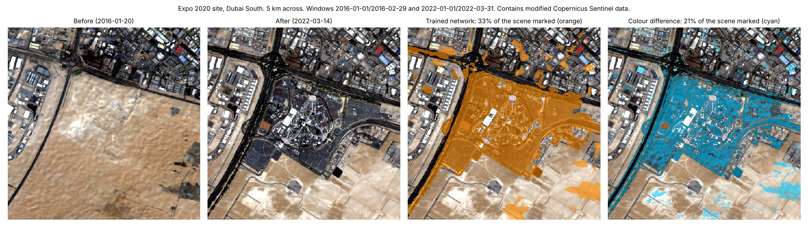
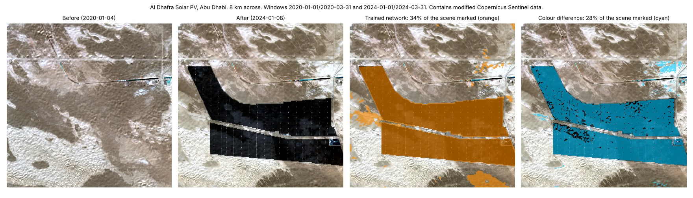
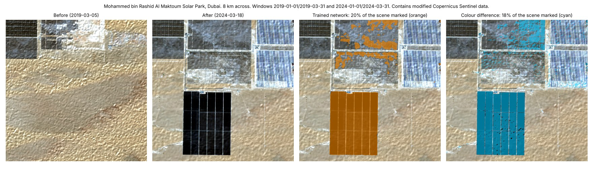

# Case studies: three places in the UAE that changed

Real Sentinel-2 pairs of places where a large, documented change happened. The aim is a before-and-after example that
anyone can check by eye, and an honest look at what the method marks and what it misses.

**These sites have no answer key.** Nothing on this page is a score. The numbers are the share of each scene that a
method marked. The scored evaluation is in [`V2_RESULTS.md`](V2_RESULTS.md).

An interactive version with a before/after slider is at [`case-studies.html`](case-studies.html).

## 1. The sites

<!-- v2:case_sites file=case_studies.json -->
| Site | What changed, and when | Scene centre (`--center` is lon,lat) | Size | Before window | After window | Sources |
| --- | --- | --- | --- | --- | --- | --- |
| **Expo 2020 site, Dubai South** (`expo2020`) | Open desert became the Expo 2020 exhibition site. Site development began in March 2016 and the Expo ran from 1 October 2021 to 31 March 2022, so the first window is before any work and the second is while the Expo was open. | 24.9608 N, 55.1508 E. Coordinates listed for Expo 2020 on Wikipedia (24.96083 N, 55.15083 E). | 5 km | 2016-01-01 to 2016-02-29 | 2022-01-01 to 2022-03-31 | [Gulf Construction: site development began in March 2016](https://gulfconstructiononline.com/Article/1625776/Eyeing_a_better_future); [Jacobs: 438-hectare site, open 1 October 2021 to 31 March 2022](https://www.jacobs.com/projects/Expo-2020-Dubai); [Wikipedia: Expo 2020 (coordinates, dates)](https://en.wikipedia.org/wiki/Expo_2020) |
| **Al Dhafra Solar PV, Abu Dhabi** (`aldhafra_solar`) | A 2 GW solar plant covering more than 20 square kilometres was built on open desert. Construction began in 2020, panel installation finished in April 2023 and the plant was inaugurated on 16 November 2023. | 24.1456 N, 54.5139 E. Approximate plant coordinates from Global Energy Monitor (24.1456, 54.5139). | 8 km | 2020-01-01 to 2020-03-31 | 2024-01-01 to 2024-03-31 | [PV Tech: Masdar inaugurates 2 GW Al Dhafra project (17 November 2023)](https://www.pv-tech.org/masdar-inaugurates-worlds-largest-2gw-solar-project-in-abu-dhabi); [Masdar: Al Dhafra Solar PV project page (completed 2023)](https://masdar.ae/en/renewables/our-projects/al-dhafra-solar-pv); [Blackridge Research: timeline (construction from 2020, panels complete April 2023)](https://www.blackridgeresearch.com/project-profiles/al-dhafra-solar-plant-abu-dhabi-dubai-uae); [Global Energy Monitor: Al Dhafra solar farm (approximate coordinates)](https://gem.wiki/Al_Dhafra_solar_farm) |
| **Mohammed bin Rashid Al Maktoum Solar Park, Dubai** (`mbr_solar`) | New solar arrays were added to an existing solar park. Between the two windows DEWA commissioned the later stages of phase 3 (2019 to 2020), phase 5 (900 MW, August 2021 to June 2023) and phase 4 (950 MW, 2023). The scene also keeps part of the older arrays, which did not change. | 24.7254 N, 55.4237 E. The park's listed coordinates (24.7547 N, 55.365 E, Wikipedia) fall on arrays that already existed in 2019. The scene centre was moved about 6.7 km to the south-east, onto the new arrays, after looking at a 20 km Sentinel-2 view of the park. Which phase each new block belongs to is not confirmed by a source. | 8 km | 2019-01-01 to 2019-03-31 | 2024-01-01 to 2024-03-31 | [PV Tech: 900 MW fifth phase inaugurated (19 June 2023)](https://www.pv-tech.org/uae-inaugurates-900mw-fifth-phase-of-mohammed-bin-rashid-al-maktoum-solar-park); [SolarQuarter: phases 4 and 5 commissioned in 2023, phase 6 under development](https://solarquarter.com/2025/06/10/dewa-boosts-clean-energy-capacity-to-3860mw-at-mohammed-bin-rashid-al-maktoum-solar-park/); [Wikipedia: Mohammed bin Rashid Al Maktoum Solar Park (coordinates, phase dates)](https://en.wikipedia.org/wiki/Mohammed_bin_Rashid_Al_Maktoum_Solar_Park) |
<!-- /v2 -->

Both windows of every site fall in the same season (January to March), so the sun angle is similar on both dates.

Each change is documented by sources that do not depend on this project. They are listed in the table and in
[`data/case_studies.json`](data/case_studies.json), which is the single place the sites are defined.

## 2. Imagery

Fetched with the project's own `scripts/fetch_sentinel2.py` (Sentinel-2 Level-2A from Microsoft Planetary Computer).
Each image is the per-pixel median of the three least cloudy acquisitions in its window. No imagery is committed to
git; it is written to `data/real/`.

<!-- v2:case_fetch file=v2_case_studies.json -->
**Expo 2020 site, Dubai South**

```bash
python scripts/fetch_sentinel2.py --center=55.1508,24.9608 --size 5 --before 2016-01-01/2016-02-29 --after 2022-01-01/2022-03-31 --scene expo2020 --output data/real --cloud-max 10 --limit 3 --no-scl
```

| Window | Date | Sentinel-2 acquisition | Cloud cover of the tile | Processing baseline | 1000 offset removed |
| --- | ---: | ---: | ---: | ---: | ---: |
| before | 2016-01-20 | `S2A_MSIL2A_20160120T065212_R020_T40RCN_20210527T203424` | 2.69% | 03.00 | no |
| before | 2016-02-19 | `S2A_MSIL2A_20160219T064922_R020_T40RCN_20210528T083408` | 3.07% | 03.00 | no |
| before | 2016-02-09 | `S2A_MSIL2A_20160209T065032_R020_T40RCN_20210528T041938` | 5.91% | 03.00 | no |
| after | 2022-03-14 | `S2B_MSIL2A_20220314T064639_R020_T40RCN_20240526T072428` | 0.02% | 05.10 | yes |
| after | 2022-03-14 | `S2B_MSIL2A_20220314T064639_R020_T40RCN_20220314T182045` | 0.02% | 04.00 | yes |
| after | 2022-02-12 | `S2B_MSIL2A_20220212T065009_R020_T40RCN_20220222T045704` | 0.03% | 04.00 | yes |

Output grid: 508 × 508 pixels at 10 m, both dates on the same grid.

**Al Dhafra Solar PV, Abu Dhabi**

```bash
python scripts/fetch_sentinel2.py --center=54.5139,24.1456 --size 8 --before 2020-01-01/2020-03-31 --after 2024-01-01/2024-03-31 --scene aldhafra_solar --output data/real --cloud-max 10 --limit 3 --no-scl
```

| Window | Date | Sentinel-2 acquisition | Cloud cover of the tile | Processing baseline | 1000 offset removed |
| --- | ---: | ---: | ---: | ---: | ---: |
| before | 2020-01-04 | `S2B_MSIL2A_20200104T065249_R020_T40QBM_20201002T225332` | 0.10% | 02.12 | no |
| before | 2020-01-04 | `S2B_MSIL2A_20200104T065249_R020_T39QZG_20201002T225336` | 0.10% | 02.12 | no |
| before | 2020-01-07 | `S2B_MSIL2A_20200107T070249_R063_T40QBM_20201029T121609` | 0.16% | 02.12 | no |
| after | 2024-01-08 | `S2A_MSIL2A_20240108T065251_R020_T39QZG_20240108T113844` | 0.10% | 05.10 | yes |
| after | 2024-01-08 | `S2A_MSIL2A_20240108T065251_R020_T40QBM_20240108T111557` | 0.10% | 05.10 | yes |
| after | 2024-02-10 | `S2A_MSIL2A_20240210T070031_R063_T39QZG_20240210T121118` | 0.13% | 05.10 | yes |

Output grid: 816 × 816 pixels at 10 m, both dates on the same grid.

**Mohammed bin Rashid Al Maktoum Solar Park, Dubai**

```bash
python scripts/fetch_sentinel2.py --center=55.4237,24.7254 --size 8 --before 2019-01-01/2019-03-31 --after 2024-01-01/2024-03-31 --scene mbr_solar --output data/real --cloud-max 10 --limit 3 --no-scl
```

| Window | Date | Sentinel-2 acquisition | Cloud cover of the tile | Processing baseline | 1000 offset removed |
| --- | ---: | ---: | ---: | ---: | ---: |
| before | 2019-03-05 | `S2A_MSIL2A_20190305T064741_R020_T40RCN_20201030T153903` | 0.45% | 02.12 | no |
| before | 2019-02-08 | `S2B_MSIL2A_20190208T065029_R020_T40RCN_20201007T150731` | 0.64% | 02.12 | no |
| before | 2019-02-18 | `S2B_MSIL2A_20190218T064929_R020_T40RCN_20201007T181029` | 0.68% | 02.12 | no |
| after | 2024-03-18 | `S2A_MSIL2A_20240318T064621_R020_T40RCN_20240318T123327` | 0.06% | 05.10 | yes |
| after | 2024-03-13 | `S2B_MSIL2A_20240313T064639_R020_T40RCN_20240313T120500` | 0.18% | 05.10 | yes |
| after | 2024-02-22 | `S2B_MSIL2A_20240222T064909_R020_T40RCN_20240222T113956` | 0.41% | 05.10 | yes |

Output grid: 812 × 810 pixels at 10 m, both dates on the same grid.
<!-- /v2 -->

Two things had to be handled to get usable pairs. Both matter for anyone fetching Gulf imagery:

- **A brightness jump in January 2022.** Sentinel-2 images processed with baseline 04.00 or later store every value
  1000 higher. All three pairs straddle that date, so the "after" image was uniformly brighter and almost everything
  looked changed. On a patch of open desert near Al Dhafra the blue-band median was 1844 in January 2020 and 3063 in
  January 2024. `fetch_sentinel2.py` now removes the offset, and a test covers it.
- **The cloud mask flags bright ground.** With Sentinel-2's own scene classification used as a cloud mask, 31% of the
  2016 Expo image was thrown away: bright roofs and pale sand were classed as cloud. The mirror field at the solar
  park was also masked. The three pairs are therefore fetched with `--no-scl`, relying on the 10% cloud limit and the
  three-image median instead. The images were checked by eye and show no cloud.

## 3. What was run

`python scripts/run_case_studies.py` runs, for each site:

- **The trained network** from Part A (`configs/v2/baseline.json`, seed 42) through `sat_change.predict`.
- **The colour difference** with a shared stretch.

Each method is cut at the threshold fitted for it on the OSCD validation scenes (Step A4). Score maps and masks are
written to `outputs/v2/<site>/` as GeoTIFFs on the image grid.

One caveat applies to every result here: the thresholds were fitted on OSCD, which is Level-1C imagery, and are
applied to Level-2A imagery. The inputs are stretched to a common range first, which limits the mismatch, but the
thresholds are not tuned for these scenes.

<!-- v2:case_studies file=v2_case_studies.json -->
| Site | Dates of the best acquisition in each window | Size (pixels) | Marked by the trained network | Marked by the colour difference | Overlap of the two masks (IoU) |
| --- | ---: | ---: | ---: | ---: | ---: |
| Expo 2020 site, Dubai South | 2016-01-20 to 2022-03-14 | 508 × 508 | 33.3% | 20.6% | 0.52 |
| Al Dhafra Solar PV, Abu Dhabi | 2020-01-04 to 2024-01-08 | 816 × 816 | 33.6% | 27.6% | 0.79 |
| Mohammed bin Rashid Al Maktoum Solar Park, Dubai | 2019-03-05 to 2024-03-18 | 812 × 810 | 19.5% | 18.1% | 0.68 |
<!-- /v2 -->

## 4. What each method found and missed

In every figure: before, after, then the after image with the network's marks in orange, then with the colour
difference's marks in cyan.

### Expo 2020 site, Dubai South



*5 km across. Windows 1 January to 29 February 2016 and 1 January to 31 March 2022. Site development began in March
2016 and the Expo ran from October 2021 to March 2022 (sources in the table above). Contains modified Copernicus
Sentinel data.*

- **Found.** Both methods mark the Expo site, which was open sand in 2016. The network marks it as one solid region
  that follows the site boundary and the new roads around it. The colour difference marks the same area as speckle.
- **Missed.** The brightest white roofs inside the site are left unmarked by the network. Pale sand became a pale
  roof, so after the brightness stretch the two dates look alike there.
- **Wrongly marked.** The colour difference marks many roofs in the industrial area to the north, which was already
  built in 2016. Roof brightness depends on sun angle, and the 2016 image is built from January and February
  acquisitions while the 2022 one is mostly from mid-March. The network marks a few rounded patches of open desert
  in the south-east, where the sand tone differs between the dates.

### Al Dhafra Solar PV, Abu Dhabi



*8 km across. Windows 1 January to 31 March 2020 and 1 January to 31 March 2024. Construction began in 2020 and the
plant was inaugurated in November 2023. Contains modified Copernicus Sentinel data.*

- **Found.** Both methods outline the plant closely. This is the easy case: dark panels on pale desert.
- **Missed.** The colour difference leaves holes inside the plant where the ground was already dark gravel in 2020,
  so the colour changed less. The network fills those holes, because it compares neighbourhoods and not single
  pixels.
- **Wrongly marked.** The network marks a few patches of dunes at the left edge and the bottom of the scene. The
  colour difference marks pale salt-flat surfaces in the north-east. Neither area was built on. Both are surface
  brightness changes, the kind that rain, wind-blown sand or haze cause in this region.

### Mohammed bin Rashid Al Maktoum Solar Park, Dubai



*8 km across. Windows 1 January to 31 March 2019 and 1 January to 31 March 2024. Phases 3 (later stages), 4 and 5
were commissioned between the two dates. Contains modified Copernicus Sentinel data.*

- **Found.** Both methods mark the new dark panel block in the south of the scene cleanly.
- **Missed, by both.** Most of the other new construction. The blue-white mirror field in the east and the grey
  arrays across the middle were open desert in 2019, and neither method marks more than fragments of them. At 10 m
  per pixel these arrays read as slightly greyer or bluer sand: mirrors reflect the sky, and rows of tilted panels
  are mixed with the sand between them. The change is real and large on the ground, but it is smaller in colour than
  the threshold fitted on OSCD's urban scenes. This is the clearest failure on the page.
- **Wrongly marked.** Little. The older arrays in the north-west, which did not change, are correctly left alone by
  both methods.

## 5. What the case studies say

- On big, high-contrast changes (dark panels or dense building on sand) the network and the colour difference agree,
  and the network's mask is cleaner. That fits how the network works, and it does not contradict the benchmark, where
  changes are small and the network is worse.
- The miss at the solar park shows the limit of one fixed threshold. A threshold fitted on European and Asian cities
  does not carry over to low-contrast change on sand.
- False marks in open desert are brightness changes of the surface. No cloud or cloud shadow is present in these
  pairs, and there is almost no vegetation, so the usual seasonal false alarms do not arise here. Sun angle still
  matters for bright roofs.
- These are three hand-picked sites with obvious changes. They show what the output looks like. They do not measure
  accuracy.

## Reproduce

```bash
pip install -e ".[geo,fetch,figures]"
python scripts/run_case_studies.py --fetch      # downloads the three pairs, then runs both methods
python scripts/build_case_studies_page.py       # writes docs/case-studies.html
python scripts/render_v2_tables.py
```

`run_case_studies.py` needs the Part A checkpoint (`outputs/v2/runs/baseline/seed42/best.pt`) and
`docs/data/v2_results.json`. See [`V2_RESULTS.md`](V2_RESULTS.md) for how to produce them.
