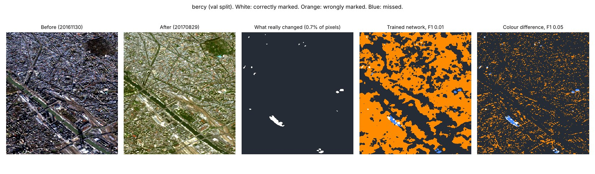
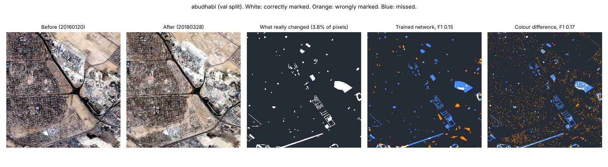
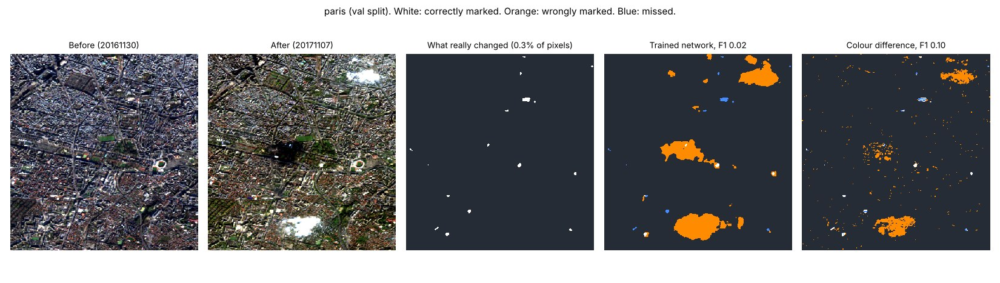
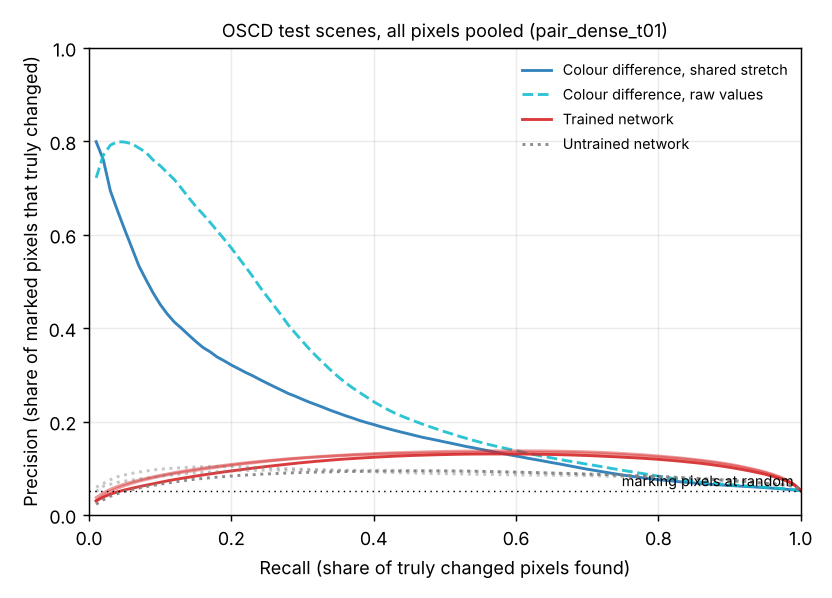
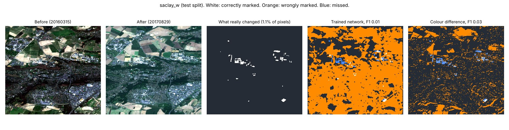
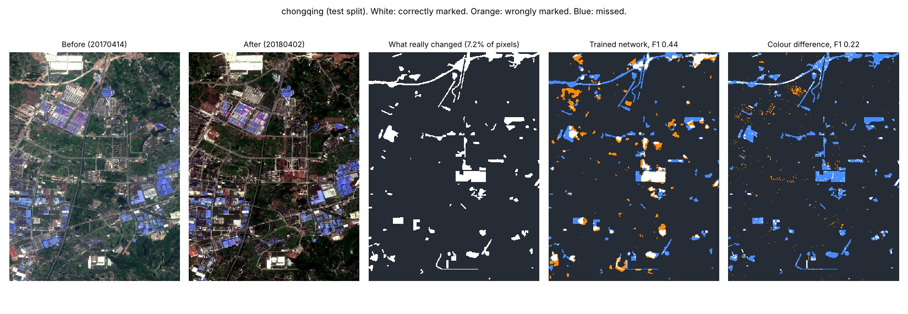

# v2 results on real data

**Short answer.** On real Sentinel-2 scenes the v1 network does not beat a plain colour difference. It is clearly
worse, and pretraining does not help it: on the test scenes the same network with random weights scores slightly
higher. Section 6 below reports what changed after the model-improvement loop.

Every number in a table on this page is generated from a result file in `docs/data/` by
`scripts/render_v2_tables.py`. A test fails if a table and its file disagree.

## 1. What was tested

- **Data.** OSCD: 24 registered Sentinel-2 pairs with hand-drawn masks of urban change. Source, licence and bands are
  in [`DATA_SOURCES.md`](DATA_SOURCES.md).
- **Split, by scene** ([`data/splits_v2.json`](data/splits_v2.json)). 9 train scenes for pretraining (imagery only),
  5 validation scenes for choosing thresholds, and OSCD's 10 official test scenes.
- **Methods.** The v1 pipeline unchanged (`configs/v2/baseline.json`): a small CNN pretrained with a contrastive
  loss on single images, then cosine distance between before and after features at three scales. It is compared with
  the same network with random weights, and with two colour differences that use no network.
- **Seeds.** Three for each network (42, 43, 44). Tables show the mean ± standard deviation over seeds. The colour
  differences have no randomness.
- **Test passes.** The test scenes were scored once for this configuration. Every test pass is recorded in
  [`data/v2_test_ledger.json`](data/v2_test_ledger.json), and the script refuses a second pass without a stated reason.

How to read the columns: AUROC and PR-AUC measure how well a method ranks changed pixels above unchanged ones, before
any cut-off. PR-AUC is the stricter of the two when changed pixels are rare, as here (about 5% of test pixels). F1,
IoU, precision and recall score the final changed/unchanged map. All pixels of all test scenes are counted together
unless a table says otherwise.

## 2. Test results with a threshold chosen on validation scenes

One threshold per method, fitted on the five validation scenes, then applied unchanged to the ten test scenes.

<!-- v2:test_main file=v2_results.json -->
| Method | AUROC | PR-AUC | F1 | IoU | Precision | Recall |
| --- | ---: | ---: | ---: | ---: | ---: | ---: |
| Trained network | 0.628 ± 0.005 | 0.075 ± 0.002 | 0.127 ± 0.003 | 0.068 ± 0.002 | 0.079 ± 0.003 | 0.330 ± 0.062 |
| Same network, untrained (random weights) | 0.687 ± 0.008 | 0.081 ± 0.003 | 0.152 ± 0.003 | 0.082 ± 0.002 | 0.090 ± 0.003 | 0.488 ± 0.005 |
| Colour difference, shared stretch | 0.738 | 0.214 | 0.270 | 0.156 | 0.261 | 0.278 |
| Colour difference, raw values | 0.760 | 0.291 | 0.330 | 0.197 | 0.442 | 0.263 |
<!-- /v2 -->

The same results averaged per scene instead of per pixel (each scene counts once, whatever its size):

<!-- v2:test_scene_mean file=v2_results.json -->
| Method | AUROC | PR-AUC | F1 | IoU | Precision | Recall |
| --- | ---: | ---: | ---: | ---: | ---: | ---: |
| Trained network | 0.652 ± 0.006 | 0.176 ± 0.011 | 0.160 ± 0.010 | 0.096 ± 0.006 | 0.216 ± 0.027 | 0.299 ± 0.062 |
| Same network, untrained (random weights) | 0.719 ± 0.008 | 0.213 ± 0.021 | 0.208 ± 0.018 | 0.127 ± 0.013 | 0.162 ± 0.018 | 0.511 ± 0.027 |
| Colour difference, shared stretch | 0.740 | 0.254 | 0.241 | 0.150 | 0.378 | 0.255 |
| Colour difference, raw values | 0.735 | 0.254 | 0.220 | 0.137 | 0.398 | 0.204 |
<!-- /v2 -->


*Precision-recall curves, all test pixels pooled. Higher is better. Faint lines are the other two seeds.*

## 3. How the threshold was chosen

**Rule.** For each method, take the single threshold that gives the highest F1 over all validation pixels pooled.
Apply that one number to every test scene. Nothing is fitted on a test scene.

<!-- v2:val_thresholds file=v2_results.json -->
| Method | Threshold fitted on validation | Validation F1 at that threshold | Validation F1, leave one scene out | Validation F1, per-scene Otsu |
| --- | ---: | ---: | ---: | ---: |
| Trained network (seed 42) | 0.5656 | 0.169 | 0.135 | 0.083 |
| Trained network (seed 43) | 0.6928 | 0.187 | 0.135 | 0.080 |
| Trained network (seed 44) | 0.6689 | 0.199 | 0.165 | 0.085 |
| Same network, untrained (random weights) (seed 42) | 0.1466 | 0.099 | 0.098 | 0.083 |
| Same network, untrained (random weights) (seed 43) | 0.1009 | 0.098 | 0.091 | 0.076 |
| Same network, untrained (random weights) (seed 44) | 0.08712 | 0.095 | 0.085 | 0.077 |
| Colour difference, shared stretch | 0.8069 | 0.226 | 0.224 | 0.137 |
| Colour difference, raw values | 1885 | 0.266 | 0.268 | 0.146 |
<!-- /v2 -->

"Leave one scene out" cuts each validation scene with a threshold fitted on the other four. It is the fairer
estimate of what the threshold will do on a new scene. For the network it is well below the F1 at the fitted
threshold, which means the network's scores sit on a different scale from scene to scene and one global threshold
does not transfer well. The colour differences barely move.

**Compared with v1's rule (per-scene Otsu, no labels), on the test scenes:**

<!-- v2:test_otsu file=v2_results.json -->
| Method | AUROC | PR-AUC | F1 | IoU | Precision | Recall |
| --- | ---: | ---: | ---: | ---: | ---: | ---: |
| Trained network | 0.628 ± 0.005 | 0.075 ± 0.002 | 0.155 ± 0.001 | 0.084 ± 0.001 | 0.087 ± 0.001 | 0.698 ± 0.012 |
| Same network, untrained (random weights) | 0.687 ± 0.008 | 0.081 ± 0.003 | 0.247 ± 0.015 | 0.141 ± 0.010 | 0.154 ± 0.012 | 0.628 ± 0.039 |
| Colour difference, shared stretch | 0.738 | 0.214 | 0.237 | 0.134 | 0.150 | 0.564 |
| Colour difference, raw values | 0.760 | 0.291 | 0.233 | 0.132 | 0.147 | 0.566 |
<!-- /v2 -->

The validation threshold helps the colour differences (F1 0.237 to 0.270 and 0.233 to 0.330). It does not help the
networks: the trained network drops from 0.155 to 0.127 and the untrained one from 0.247 to 0.152. Otsu adapts to
each scene, which hides the scale drift; a single global threshold exposes it.

## 4. Network against the baselines, scene by scene

<!-- v2:paired file=v2_results.json split=test -->
| Comparison | Pooled F1 difference | 95% interval (scenes resampled) | Per-scene F1 difference, mean ± spread | Scenes the trained network wins |
| --- | ---: | ---: | ---: | ---: |
| Trained (seed 42) minus colour difference (shared stretch) | -0.140 | -0.197 to -0.039 | -0.069 ± 0.061 | 1 of 10 |
| Trained (seed 42) minus untrained network (same seed) | -0.023 | -0.096 to -0.007 | -0.059 ± 0.065 | 1 of 10 |
| Trained (seed 43) minus colour difference (shared stretch) | -0.141 | -0.204 to -0.024 | -0.082 ± 0.093 | 1 of 10 |
| Trained (seed 43) minus untrained network (same seed) | -0.028 | -0.075 to -0.002 | -0.045 ± 0.054 | 1 of 10 |
| Trained (seed 44) minus colour difference (shared stretch) | -0.147 | -0.211 to -0.036 | -0.093 ± 0.078 | 1 of 10 |
| Trained (seed 44) minus untrained network (same seed) | -0.025 | -0.082 to +0.010 | -0.040 ± 0.064 | 2 of 10 |
<!-- /v2 -->

The interval comes from resampling whole scenes 2,000 times, so it reflects how much the answer depends on which ten
scenes happen to be in the test set.

Per-scene F1 at the validation threshold and per-scene AUROC (networks: seed 42):

<!-- v2:per_scene file=v2_results.json split=test seed=seed42 -->
| Scene | Trained F1 | Trained AUROC | Untrained F1 | Untrained AUROC | Diff shared F1 | Diff shared AUROC | Diff raw F1 | Diff raw AUROC |
| --- | ---: | ---: | ---: | ---: | ---: | ---: | ---: | ---: |
| brasilia | 0.118 | 0.772 | 0.308 | 0.889 | 0.208 | 0.708 | 0.186 | 0.709 |
| chongqing | 0.207 | 0.731 | 0.326 | 0.830 | 0.215 | 0.756 | 0.080 | 0.774 |
| dubai | 0.134 | 0.806 | 0.180 | 0.806 | 0.270 | 0.788 | 0.290 | 0.788 |
| lasvegas | 0.495 | 0.855 | 0.514 | 0.895 | 0.598 | 0.863 | 0.621 | 0.873 |
| milano | 0.073 | 0.897 | 0.174 | 0.951 | 0.268 | 0.870 | 0.180 | 0.865 |
| montpellier | 0.417 | 0.853 | 0.533 | 0.947 | 0.497 | 0.843 | 0.473 | 0.830 |
| norcia | 0.012 | 0.387 | 0.022 | 0.497 | 0.061 | 0.661 | 0.060 | 0.641 |
| rio | 0.250 | 0.779 | 0.229 | 0.792 | 0.241 | 0.782 | 0.244 | 0.766 |
| saclay_w | 0.009 | 0.212 | 0.019 | 0.286 | 0.031 | 0.543 | 0.032 | 0.501 |
| valencia | 0.005 | 0.260 | 0.007 | 0.403 | 0.021 | 0.582 | 0.030 | 0.604 |
<!-- /v2 -->

## 5. Conclusions

**Does the network beat the colour-difference baseline on real data? No.** Pooled test F1 is 0.127 for the trained
network against 0.270 for the shared-stretch colour difference and 0.330 for the raw one. The gap to the shared-stretch
baseline is about 0.14 F1 for every seed, and the scene-resampled 95% interval stays below zero for every seed. Scene
by scene the picture is noisier: the trained network loses on 9 of 10 scenes, by 0.07 to 0.09 F1 on average, and the
spread of that difference across scenes is about as large as the difference itself (0.06 to 0.09). So the direction is
consistent, but ten scenes cannot pin the size of the gap down tightly. The ranking metrics agree: PR-AUC 0.075
against 0.214.

**Does pretraining help compared with random weights? No, not on this evidence.** On the test scenes the untrained
network is slightly better (F1 0.152 against 0.127, AUROC 0.687 against 0.628), and the trained network wins on only
1 or 2 of 10 scenes. On the validation scenes it was the other way round (leave-one-scene-out F1 0.145 against 0.092).
A result that flips between two sets of scenes is not evidence of a benefit.

**Where does it fail?** Three patterns, with examples from the validation scenes:

1. **Season and sun angle are read as change.** In `bercy` the first image is from late November (low sun, long
   shadows, bluish) and the second from late August. The network marks most of the city. The colour difference is
   noisy here too but marks far less.

   

2. **The score scale drifts between scenes, so one threshold misfires.** In `abudhabi` the threshold fitted across
   all validation scenes is too high for this scene, and the network misses most of the real construction (blue).

   

3. **Clouds and their shadows are marked as change.** In `paris` the second image contains two clouds and a cloud
   shadow. Both methods mark them. The network marks them as large solid blobs, which swamp the 0.3% of pixels that
   really changed.

   

On the test scenes the same weakness shows in the numbers: for `norcia`, `saclay_w` and `valencia` the trained
network's AUROC is between 0.20 and 0.39, which is worse than guessing. Its scores are highest where nothing in the mask
changed.

The failure panels are taken from validation scenes on purpose. The improvement loop is allowed to look at them, and
it must not look at test scenes.

**What this does not show.** OSCD labels only urban change, so a method that reacts to real but unlabelled change
(crops, water level) is penalised for it. The test set is ten scenes. The network is small and was trained for a few
minutes on a CPU on nine scenes. A larger or longer-trained model could behave differently.

## 6. After the model-improvement loop

The loop in [`V2_MODEL_IMPROVEMENT.md`](V2_MODEL_IMPROVEMENT.md) changed three things, each chosen on validation
scenes only ([`V2_EXPERIMENTS.md`](V2_EXPERIMENTS.md) has every experiment):

1. The coarsest feature scale was dropped from the score.
2. A second loss was added to pretraining. It takes the same patch at the two dates of a train scene and teaches the
   network to describe each position the same way on both dates. It uses no labels.
3. The contrastive temperature was lowered from 0.2 to 0.1.

The final configuration (`configs/v2/pair_dense_t01.json`) was frozen in a commit, and then scored on the test scenes
once.

**Short answer.** The improved network is clearly better than the v1 network on every measure. Against the colour
difference the result is split. On the measure fixed in advance (F1 over all test pixels pooled) it still loses:
0.185 against 0.270. Averaged per scene it wins: 0.273 against 0.241. It is better on most scenes and fails badly on
three scenes with farmland, and its false marks there are enough to decide the pooled number.

### Test results, all pixels pooled (the measure fixed in advance)

<!-- v2:test_combined file=v2_results_final.json base=v2_results.json -->
| Method | AUROC | PR-AUC | F1 | IoU | Precision | Recall |
| --- | ---: | ---: | ---: | ---: | ---: | ---: |
| v1 network, as it was (Part A) | 0.628 ± 0.005 | 0.075 ± 0.002 | 0.127 ± 0.003 | 0.068 ± 0.002 | 0.079 ± 0.003 | 0.330 ± 0.062 |
| Improved network (after the loop) | 0.785 ± 0.007 | 0.111 ± 0.004 | 0.185 ± 0.004 | 0.102 ± 0.002 | 0.125 ± 0.004 | 0.355 ± 0.002 |
| Improved scoring, untrained network | 0.694 ± 0.003 | 0.085 ± 0.003 | 0.155 ± 0.004 | 0.084 ± 0.002 | 0.092 ± 0.003 | 0.503 ± 0.021 |
| Colour difference, shared stretch | 0.738 | 0.214 | 0.270 | 0.156 | 0.261 | 0.278 |
| Colour difference, raw values | 0.760 | 0.291 | 0.330 | 0.197 | 0.442 | 0.263 |
<!-- /v2 -->

### Test results, averaged per scene

<!-- v2:test_scene_mean file=v2_results_final.json -->
| Method | AUROC | PR-AUC | F1 | IoU | Precision | Recall |
| --- | ---: | ---: | ---: | ---: | ---: | ---: |
| Trained network | 0.760 ± 0.006 | 0.321 ± 0.007 | 0.273 ± 0.001 | 0.179 ± 0.001 | 0.400 ± 0.014 | 0.288 ± 0.004 |
| Same network, untrained (random weights) | 0.717 ± 0.013 | 0.203 ± 0.022 | 0.203 ± 0.019 | 0.123 ± 0.014 | 0.155 ± 0.022 | 0.518 ± 0.015 |
| Colour difference, shared stretch | 0.740 | 0.254 | 0.241 | 0.150 | 0.378 | 0.255 |
| Colour difference, raw values | 0.735 | 0.254 | 0.220 | 0.137 | 0.398 | 0.204 |
<!-- /v2 -->

("Trained network" in this table and the ones below is the improved network.)



### Improved network against the references, scene by scene

<!-- v2:paired file=v2_results_final.json split=test -->
| Comparison | Pooled F1 difference | 95% interval (scenes resampled) | Per-scene F1 difference, mean ± spread | Scenes the trained network wins |
| --- | ---: | ---: | ---: | ---: |
| Trained (seed 42) minus colour difference (shared stretch) | -0.090 | -0.139 to +0.081 | +0.034 ± 0.077 | 6 of 10 |
| Trained (seed 42) minus untrained network (same seed) | +0.022 | -0.014 to +0.149 | +0.046 ± 0.063 | 6 of 10 |
| Trained (seed 43) minus colour difference (shared stretch) | -0.083 | -0.128 to +0.076 | +0.032 ± 0.075 | 5 of 10 |
| Trained (seed 43) minus untrained network (same seed) | +0.028 | -0.010 to +0.168 | +0.076 ± 0.083 | 6 of 10 |
| Trained (seed 44) minus colour difference (shared stretch) | -0.081 | -0.128 to +0.082 | +0.031 ± 0.073 | 5 of 10 |
| Trained (seed 44) minus untrained network (same seed) | +0.038 | -0.012 to +0.215 | +0.088 ± 0.094 | 7 of 10 |
<!-- /v2 -->

<!-- v2:per_scene file=v2_results_final.json split=test seed=seed42 -->
| Scene | Trained F1 | Trained AUROC | Untrained F1 | Untrained AUROC | Diff shared F1 | Diff shared AUROC | Diff raw F1 | Diff raw AUROC |
| --- | ---: | ---: | ---: | ---: | ---: | ---: | ---: | ---: |
| brasilia | 0.222 | 0.929 | 0.277 | 0.883 | 0.208 | 0.708 | 0.186 | 0.709 |
| chongqing | 0.444 | 0.899 | 0.321 | 0.818 | 0.215 | 0.756 | 0.080 | 0.774 |
| dubai | 0.245 | 0.889 | 0.202 | 0.811 | 0.270 | 0.788 | 0.290 | 0.788 |
| lasvegas | 0.641 | 0.946 | 0.528 | 0.899 | 0.598 | 0.863 | 0.621 | 0.873 |
| milano | 0.333 | 0.976 | 0.185 | 0.953 | 0.268 | 0.870 | 0.180 | 0.865 |
| montpellier | 0.592 | 0.938 | 0.518 | 0.935 | 0.497 | 0.843 | 0.473 | 0.830 |
| norcia | 0.012 | 0.456 | 0.022 | 0.536 | 0.061 | 0.661 | 0.060 | 0.641 |
| rio | 0.243 | 0.846 | 0.206 | 0.783 | 0.241 | 0.782 | 0.244 | 0.766 |
| saclay_w | 0.011 | 0.271 | 0.018 | 0.304 | 0.031 | 0.543 | 0.032 | 0.501 |
| valencia | 0.005 | 0.378 | 0.007 | 0.428 | 0.021 | 0.582 | 0.030 | 0.604 |
<!-- /v2 -->

### What the numbers say

- **Against v1.** Pooled F1 rose from 0.127 to 0.185, PR-AUC from 0.075 to 0.111 and AUROC from 0.628 to 0.785. The
  gain is the same for all three seeds (standard deviation 0.004).
- **Against random weights.** Pretraining now helps. With the same scoring, the untrained network scores 0.155 pooled
  F1 and 0.203 per scene, against 0.185 and 0.273. The pooled interval still touches zero (for example -0.014 to
  +0.149 for seed 42), so this is a likely benefit, not a certain one.
- **Against the colour difference, pooled.** The network loses by 0.08 to 0.09 F1. The scene-resampled interval is
  wide and includes zero (about -0.14 to +0.08), so ten scenes cannot settle it, but the point estimate is against the
  network. PR-AUC says the same more strongly: 0.111 against 0.214.
- **Against the colour difference, per scene.** The network wins on 5 or 6 of 10 scenes, and its per-scene mean F1 and
  PR-AUC are higher (0.273 against 0.241, and 0.321 against 0.254).
- **Why the two views disagree.** On seven scenes the network ranks pixels very well (AUROC 0.85 to 0.98). On
  `norcia`, `saclay_w` and `valencia` it is worse than guessing (AUROC 0.27 to 0.49), and it marks large parts of
  those scenes. Pooled metrics count pixels, so those false marks pull precision down for the whole test set
  (0.125).



*`saclay_w`: mid-March against late August. The fields changed with the crop cycle. OSCD labels only urban change, so
none of that counts, and the network marks most of the farmland. The colour difference marks fields too, but fewer.
`norcia` and `valencia` fail the same way: a town surrounded by fields, photographed in summer and in autumn.*



*`chongqing`: the kind of scene where the network is better. Its F1 is twice the colour difference's (0.44 against
0.22). It finds much more of the real construction, at the cost of some false marks.*

- **Why validation did not warn about this.** The five validation scenes are all cities. None is farmland. The loop
  therefore selected for urban scenes, and the validation gain over the colour difference (0.292 against 0.224) did
  not carry over to a test set that contains farmland. This is a weakness of the split, which was drawn at random from
  only 14 scenes.
- **A stronger simple baseline.** Removing marked groups smaller than 8 pixels helps the colour difference on
  validation (Experiment 5). On the test scenes it gives 0.275 (shared stretch) and 0.331 (raw values) pooled F1,
  recorded in [`data/v2_results_final_post8.json`](data/v2_results_final_post8.json). The network does not gain from
  the filter (0.184).

### Verdict

Does the improved model beat the colour-difference baseline on the test scenes? **Not on the measure that was fixed
in advance.** It beats it on per-scene averages and on most individual scenes, and it is a clear step up from v1.
The honest summary is "better than a colour difference on urban scenes, much worse on farmland, and not better
overall".

Test passes: three in total, all listed in [`data/v2_test_ledger.json`](data/v2_test_ledger.json): the v1 baseline
(Part A), the final configuration, and the final configuration with the 8-pixel filter (run to get the filtered
colour-difference references).

## Reproduce

```bash
pip install -e ".[geo,test,figures]"
python scripts/fetch_benchmark.py                                   # download OSCD, about 513 MB
for seed in 42 43 44; do python scripts/train_v2.py --config configs/v2/baseline.json --seed $seed; done
python scripts/evaluate_v2.py --config configs/v2/baseline.json --seeds 42 43 44               # validation only
python scripts/evaluate_v2.py --config configs/v2/baseline.json --seeds 42 43 44 --split test \
    --rerun-reason "reproducing the published numbers"
python scripts/make_v2_figures.py pr
python scripts/make_v2_figures.py panels --config configs/v2/baseline.json \
    --results docs/data/v2_experiments/baseline.json --split val --prefix baseline_
python scripts/render_v2_tables.py
```

Training takes about 8 minutes per seed on a 2-core CPU. Checkpoints go to `outputs/v2/runs/`, which is not in git.

The improved network (section 6) is reproduced the same way with `configs/v2/pair_dense_t01.json` (about 15 minutes
per seed) and `--output docs/data/v2_results_final.json` on the test pass. `bash scripts/run_queue_v2.sh
pair_dense_t01:42 pair_dense_t01:43 pair_dense_t01:44` trains the three seeds and can be re-run after an interruption:
a resumed run gives the same weights as an uninterrupted one.

## Checks run before this was written up (Step C2)

On a fresh clone of the `v2` branch, with only the three OSCD archives copied in:

- `pytest` passed (73 tests) and `ruff check .` was clean.
- `python scripts/reproduce_results.py` ran. The synthetic results match the committed ones to seven decimal
  places; the README's synthetic table is unchanged.
- `python scripts/fetch_benchmark.py` rebuilt the benchmark folders and left the split file unchanged.
- Retraining `configs/v2/baseline.json` with seed 42 gave the same final loss (1.21916), and
  `scripts/evaluate_v2.py` gave validation scores identical to the committed ones for all four methods. Training is
  deterministic on this machine. A different CPU or PyTorch version may differ in the last digits.
- `python scripts/render_v2_tables.py --check` passed, and no tracked file is over 5 MB.

Not re-run on the fresh clone: the two pair-trained configurations (15 minutes per seed) and the test passes, which
are limited to one per configuration.

